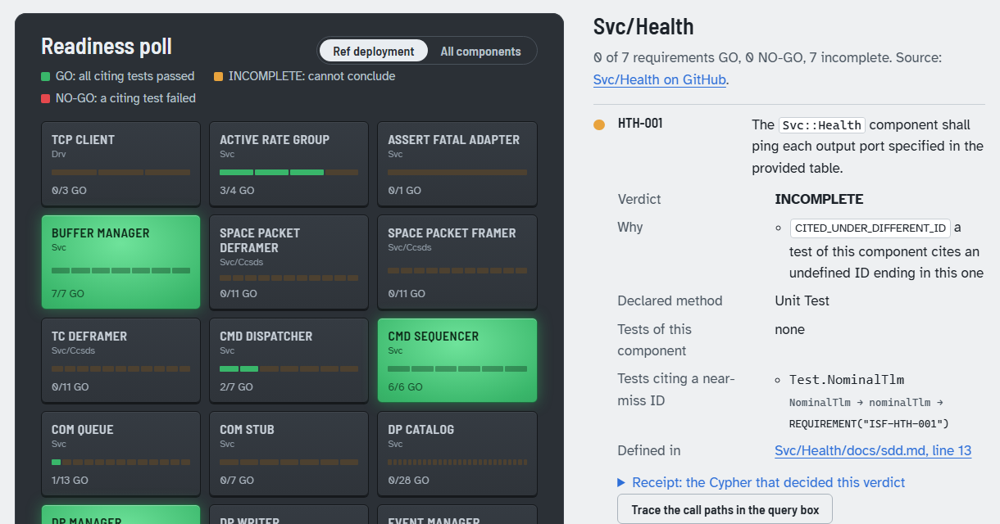

# GoNoGo

**Is this flight-software requirement actually verified, and which tests must I re-run after this change?**
GoNoGo turns an [F´ (F Prime)](https://github.com/nasa/fprime) flight-software repository into one
[Relate](https://github.com/relatedb/relate) graph and answers with receipts: the Cypher it ran, the test cases it
followed, and the CI run that produced the evidence. It says **GO** only when a requirement is backed by passing tests,
and **INCOMPLETE**, with a reason, whenever it cannot know.

[](https://github.com/cokacihan/tracegraph/actions/workflows/ci.yml)
[](https://github.com/cokacihan/tracegraph/actions/workflows/fprime-unit-tests.yml)


<!-- gonogo:pitch -->
- **The finding.** F´'s own unit tests pass in CI (2649 passed, 0 failed), yet only **140 of 561** requirements are GO: named by tests that all passed, with nothing else missing; 400 are cited by no test at all. Missing links, not missing tests, and GoNoGo shows each one with its reason.
- **The fix.** `gonogo suggest` points at the test where the `REQUIREMENT()` line belongs: the place F´ developers chose is in its top 3 for 65 % of 150 cited requirements (39 % from code identifiers alone; random order: 21 %). On the real nasa/fprime PR #5170 the gate says **FAIL**; with the 2 suggested lines it says **PASS** ([closing the loop](#replayed-on-real-f-pull-requests)).
- **The proof.** 120 defects planted in real F´ sources: GoNoGo caught 120, a grep baseline 92. Every number on this page is generated by a script, and CI fails when the page and the committed data disagree.
<!-- /gonogo:pitch -->

[](#in-the-browser)
<sub>The explorer runs Relate as WebAssembly in the browser: each lamp is an F´ component, green only when every citing
test passed in CI. Here `HTH-001` is INCOMPLETE because the test cites `ISF-HTH-001`; the call path shows where.
Open the same view at `http://localhost:8000/?c=Svc/Health&r=HTH-001` after the two commands under
[In the browser](#in-the-browser).</sub>

### In numbers

<!-- gonogo:headline -->
- **561** requirements, **2309** unit-test cases, **124** components, **72** port types and the **49**-instance Ref deployment of [NASA F´](https://github.com/nasa/fprime) (commit [`6fff089e8e`](https://github.com/nasa/fprime/tree/6fff089e8e2035307105cad4b28631eea1552ff6)) in one Relate graph (13803 relationships).
- Test code as a call graph: 2230 helper functions and 5318 `CALLS` edges. Evidence is a graph path from a test case to the `REQUIREMENT()` it relies on, up to 4 calls deep in F´.
- F´'s own unit tests, **run in our CI** ([run 45468869538](https://github.com/cokacihan/tracegraph/actions/runs/45468869538)): 2665 test cases, 2649 passed, 16 skipped, 0 failed. All 393 of the 393 test cases that cite a requirement ran.
- Ref deployment poll: **57 GO**, **0 NO-GO**, **170 INCOMPLETE** of 227 requirements in 34 components. Fully GO: `Svc/BufferManager`, `Svc/CmdSequencer`, `Svc/DpManager`.
- 10 test citations of undefined IDs, 6 duplicated requirement IDs and 12 cross-component citations, found from repository text (see [Findings](#findings)).
<!-- /gonogo:headline -->

> GoNoGo is decision support built from repository text and CI results. It is not a flight-readiness authority and is
> not affiliated with NASA, JPL or the F´ project.

## Why

F´ is NASA JPL's open-source, flight-proven framework for small spacecraft software. Each component documents its
requirements in a Software Design Document table (`Requirement | Description | Verification Method`), and unit tests can
cite a requirement with `REQUIREMENT("ID")`. The pieces needed to answer "is HTH-003 verified?" are spread over Markdown
tables, C++ test helpers several calls deep, FPP models and CI logs. The pieces needed for "I changed the `Svc.Sched`
port type, what must I re-test?" are spread even further.

These are connected-context questions. In GoNoGo they become short Cypher queries over one embedded graph that lives
in the repository, runs in CI without a server, and can be queried by people, scripts and AI agents.

## Quickstart

Python 3.12 or newer; no server, no API key.

```bash
git clone https://github.com/cokacihan/tracegraph gonogo && cd gonogo
python -m pip install -r requirements.txt
python -m gonogo poll                                   # GO / NO-GO / INCOMPLETE per component (Ref deployment)
python -m gonogo why HTH-001                            # one verdict, with reasons and evidence
python -m gonogo suggest TLC-006                        # where the missing REQUIREMENT() line would go
python -m gonogo impact --files Svc/Sched/Sched.fpp --filters   # unit tests to re-run, as gtest filters
python -m gonogo findings                               # IDs that do not line up
python -m gonogo ask "What should I re-run if I change Svc/Health?"
python -m gonogo diff data/releases/fprime-v4.0.0.json data/releases/fprime-v4.4.2.json
python -m pytest
```

### In the browser

[`web/`](web) is a static explorer. It loads the same graph into Relate compiled to WebAssembly
(`@relate/relate-wasm`) and runs the very same verdict and impact Cypher in the tab. It offers:
- a readiness poll board;
- requirement-level verdicts with their tests and receipts;
- a "what must I re-run?" box;
- the release timeline;
- a free Cypher query box;
- links to one component and requirement, such as `?c=Svc/Health&r=HTH-001`.

```bash
python -m gonogo.web_export          # refresh web/data from the dataset and CI results
python -m http.server 8000 -d web    # then open http://localhost:8000
```

`why` on a requirement whose tests cite it under a different ID (real output):

<!-- gonogo:why_hth -->
```text
HTH-001  INCOMPLETE   (Svc/Health, Svc/Health/docs/sdd.md#L13)
  The `Svc::Health` component shall ping each output port specified in the provided table.
  declared methods: Unit Test   CI run 45468869538
  - CITED_UNDER_DIFFERENT_ID: a test of this component cites an undefined ID ending in this one
  tests citing a near-miss ID:
    Svc/Health::Test.NominalTlm
      path: NominalTlm -> nominalTlm -> REQUIREMENT("ISF-HTH-001")
```
<!-- /gonogo:why_hth -->

`why` on a requirement backed by passing tests (real output):

<!-- gonogo:why_tlc -->
```text
TLC-001  GO   (Svc/TlmChan, Svc/TlmChan/docs/sdd.md#L16)
  The `Svc::TlmChan` component shall provide an interface to submit telemetry
  declared methods: Unit Test   CI run 45468869538
  own tests:
    Svc/TlmChan::TlmChanTest.ProcGuardTest PASSED
      path: ProcGuardTest -> runProcGuard -> sendBuff -> REQUIREMENT("TLC-001")
    Svc/TlmChan::TlmChanTest.UpdatedFlagClearGuarded PASSED
      path: UpdatedFlagClearGuarded -> runUpdatedFlagClearGuarded -> sendBuff -> REQUIREMENT("TLC-001")
    Svc/TlmChan::TlmChanTest.MultiChannelTest PASSED
      path: MultiChannelTest -> runMultiChannel -> sendBuff -> REQUIREMENT("TLC-001")
    Svc/TlmChan::TlmChanTest.NominalChannelTest PASSED
      path: NominalChannelTest -> runNominalChannel -> sendBuff -> REQUIREMENT("TLC-001")
```
<!-- /gonogo:why_tlc -->

## Verdicts

One meaning everywhere, decided by a single Cypher query
([`gonogo/verdict.py`](gonogo/verdict.py)) and re-implemented independently in plain Python for the tests.

| Verdict | Meaning |
|---|---|
| **GO** | Every test case of the requirement's own component that cites it with `REQUIREMENT("ID")`, directly or through any chain of helper calls, **passed** in the loaded CI run, and nothing else blocks it. |
| **NO-GO** | A citing test case of the own component **failed**. Only real failures are NO-GO. |
| **INCOMPLETE** | The graph cannot conclude. Each case carries reason codes. |

| Reason code | When |
|---|---|
| `NO_CITING_TEST` | no test case cites the requirement |
| `CITED_UNDER_DIFFERENT_ID` | a test of the component cites an undefined ID that ends in this one (e.g. `ISF-HTH-001` for `HTH-001`) |
| `CITED_BY_OTHER_COMPONENT` | only tests of another component cite it |
| `AMBIGUOUS_ID` | the same requirement ID is defined more than once |
| `NO_METHOD` | the SDD row names no recognisable verification method |
| `NOT_EXECUTED` | a citing test case did not run in the loaded run |
| `EVIDENCE_OUTSIDE_REPO` | a declared method such as Inspection leaves no record in the repository (`--accept-declared` waives it when an own test passed) |

Current poll (generated):

<!-- gonogo:poll -->
| Scope | Requirements | GO | NO-GO | INCOMPLETE |
|---|---|---|---|---|
| Ref deployment (34 components) | 227 | 57 | 0 | 170 |
| All components with requirements | 561 | 140 | 0 | 421 |

INCOMPLETE reasons over all requirements (a requirement can have several):

| Reason | Requirements |
|---|---|
| `NO_CITING_TEST` | 400 |
| `EVIDENCE_OUTSIDE_REPO` | 155 |
| `NO_METHOD` | 23 |
| `AMBIGUOUS_ID` | 12 |
| `CITED_UNDER_DIFFERENT_ID` | 7 |
| `CITED_BY_OTHER_COMPONENT` | 4 |
<!-- /gonogo:poll -->

Most INCOMPLETE verdicts are **missing links, not missing tests**: F´ has thousands of passing unit tests, but only some
of them name the requirement they verify. That is the gap GoNoGo makes visible.

## Evidence: F´'s unit tests, run in our CI

[`.github/workflows/fprime-unit-tests.yml`](.github/workflows/fprime-unit-tests.yml) checks out `nasa/fprime` at the
dataset's commit, builds and runs its unit tests with F´'s own GitHub Actions, writes one gtest XML report per
executable, and converts them with [`gonogo/testresults.py`](gonogo/testresults.py) into
[`data/fprime_test_results.json`](data/fprime_test_results.json).

<!-- gonogo:ci -->
Run [45468869538](https://github.com/cokacihan/tracegraph/actions/runs/45468869538) built F´ `6fff089e8e` with the official `nasa/fprime-actions` steps and ran 136 unit-test executables: 2665 test cases, 2649 passed, 16 skipped, 0 failed. 2066 results map to test cases in the graph; 599 belong to library directories without a component (e.g. `CFDP/Checksum`) or to parameterised cases GoNoGo does not model. All 393 of 393 requirement-citing test cases ran.
<!-- /gonogo:ci -->

## Closing the gap: where would the `REQUIREMENT()` line go?

A missing link is cheap to fix once someone knows where it goes. `gonogo suggest ID` answers that for a requirement
no own test cites ([`gonogo/suggest.py`](gonogo/suggest.py)), in two Relate steps:

1. A **full-text index** (`test_vocab`) holds the words of every TEST body and test helper: identifiers split at
   underscores and camelCase (`sendCmd_HLTH_ENABLE` → send, command, health, enable), plus the text of F´'s
   `TEST_CASE()` and `COMMENT()` descriptions. Comments and other strings are left out, so an existing
   `REQUIREMENT("ID")` gives nothing away. Relate ranks the requirement's words against it (BM25).
2. The **call graph** lifts a matching helper to the test cases that run it, `(tc)-[:CALLS*0..8]->(site)`, with their
   status in the CI run.

If a test already cites a near-miss ID (`ISF-HTH-003` for `HTH-003`), the answer is a rename, not a new citation.
`--patch` prints a diff for `git apply` that writes the line, and the include it needs. A suggestion is a candidate for
a reviewer, never evidence: the verdict only turns GO after the line is written and the test passes in CI.

<!-- gonogo:suggest_tlc -->
```text
TLC-006  (Svc/TlmChan)
  The `Svc::TlmChan` component shall emit a `WARNING_HI` event when the per-run processing cap is reached
  words matched against the component's test code: emit warn event run process cap reach
  best-matching test code (Relate full-text index, BM25):
      9.3  function checkGuardEvent                      Svc/TlmChan/test/ut/TlmChanTester.cpp:404
      3.5  TEST     TlmChanTest.ProcGuardTest            Svc/TlmChan/test/ut/TlmChanMain.cpp:59
      3.1  TEST     TlmChanTest.BucketPoolExhaustionTest Svc/TlmChan/test/ut/TlmChanMain.cpp:69
      3.0  function runProcGuard                         Svc/TlmChan/test/ut/TlmChanTester.cpp:202
      2.1  TEST     TlmChanTest.UpdatedFlagClearGuarded  Svc/TlmChan/test/ut/TlmChanMain.cpp:51
  test cases that execute it (call graph):
      9.3  TlmChanTest.ProcGuardTest                    PASSED   via checkGuardEvent -> ProcGuardTest -> runProcGuard
      3.1  TlmChanTest.BucketPoolExhaustionTest         PASSED   via BucketPoolExhaustionTest -> runBucketPoolExhaustion
      2.1  TlmChanTest.UpdatedFlagClearGuarded          PASSED   via UpdatedFlagClearGuarded -> runUpdatedFlagClearGuarded
      1.2  TlmChanTest.NominalChannelTest               PASSED   via NominalChannelTest -> doRun -> runNominalChannel
      1.2  TlmChanTest.MultiChannelTest                 PASSED   via MultiChannelTest -> doRun -> runMultiChannel

  suggested edit: add REQUIREMENT("TLC-006"); to function checkGuardEvent (Svc/TlmChan/test/ut/TlmChanTester.cpp:404), if it checks this
  A suggestion is not evidence: the verdict turns GO only when the line is written and the test passes in CI.
```
<!-- /gonogo:suggest_tlc -->

**How good are the suggestions?** Every requirement that F´'s tests cite today is a test question with a known answer:

<!-- gonogo:suggest_eval -->
150 requirements in 25 components are cited today by test code of their own component. For each, `suggest` ranked that component's test code without reading the citations (median 37 test bodies and helpers, 13 test cases per requirement), and we looked up where F´ developers actually wrote the macro:

| Ranking | Cite site in top 1 | top 3 | top 5 | Citing test case in top 1 | top 3 | top 5 |
|---|---:|---:|---:|---:|---:|---:|
| `suggest` | 44 % | 65 % | 73 % | 62 % | 85 % | 89 % |
| identifiers only (no TEST_CASE/COMMENT text) | 19 % | 39 % | 53 % | 54 % | 77 % | 85 % |
| case ranked by its own TEST body only | – | – | – | 59 % | 76 % | 79 % |
| random order (exact expectation) | 7 % | 21 % | 32 % | 24 % | 50 % | 64 % |

Generated by [`eval/suggest_eval.py`](eval/suggest_eval.py) (101.0 s); details in [`eval/SUGGEST_RESULTS.md`](eval/SUGGEST_RESULTS.md). Leak check: in 0 of 453 (requirement, cite site) pairs do the test descriptions carry 80 % or more of the requirement's words.
<!-- /gonogo:suggest_eval -->

## Change impact

F´ unit tests run per component against an autocoded harness, so GoNoGo applies these rules
([`gonogo/impact.py`](gonogo/impact.py)):

- **A changed component directory**: re-run that component's unit tests. A change to the component's own `.cpp` stays
  local, because its interface did not change.
- **A changed header, or any change in library code** (a directory without an FPP component, such as `Fw/Types` or
  `Utils/Types`): also re-run the tests of every component that includes it, directly or through other units. The
  importer reads every `#include` in the checkout into `INCLUDES` edges, and the query finds the shortest chain with
  `shortestPath((component)-[:INCLUDES*1..12]->(changed))`. The chain is printed as the reason.
- **A changed FPP model** (`.fpp`, `.fppi`) counts as a header change: the autocoder turns it into the headers that
  other units include.
- **A changed port-type definition**: re-run the unit tests of every component that uses the port type.
- **A changed FPP configuration file** (`default/config/*.fpp`: constants, sizes, configuration types): every FPP model
  can see it, so the unit tests of every component are re-run.
- **A changed deployment topology**: listed for integration review only, because it does not change which unit tests break.

The include graph is kept per directory, not per file, so it errs on the safe side: a component that includes any
header of a changed directory is listed, even if it does not use the changed file. A re-run set that is too large costs
CI minutes; one that is too small lets a broken test through.

Requirements that are GO today and depend on a re-run test are reported as *GO pending re-run*.

<!-- gonogo:impact_sched -->
```text
  changes that reach every includer: Svc/Sched
Unit tests to re-run: 1156 test cases in 28 components
  Svc/Sched                                   0 cases   changed
  Drv/PosixUartDriver                         0 cases   uses port:Svc.Sched as run
  Svc/ActivePhaser                            8 cases   uses port:Svc.Sched as PhaserMemberOut
  Svc/ActiveRateGroup                         4 cases   uses port:Svc.Sched as RateGroupMemberOut
  Svc/BufferManager                           5 cases   uses port:Svc.Sched as schedIn
  Svc/Ccsds/CfdpManager                     217 cases   uses port:Svc.Sched as run1Hz
  Svc/CmdDispatcher                          15 cases   uses port:Svc.Sched as run
  Svc/CmdSequencer                           97 cases   uses port:Svc.Sched as schedIn
  Svc/ComAggregator                          30 cases   uses port:Svc.Sched as timeout
  Svc/ComLoggerDp                            29 cases   uses port:Svc.Sched as schedIn
  Svc/ComQueue                               31 cases   uses port:Svc.Sched as run
  Svc/DpManager                              10 cases   uses port:Svc.Sched as schedIn
  Svc/DpWriter                               18 cases   uses port:Svc.Sched as schedIn
  Svc/EventManager                            7 cases   uses port:Svc.Sched as run
  Svc/FileDownlink                            9 cases   uses port:Svc.Sched as Run
  Svc/FileManager                            32 cases   uses port:Svc.Sched as schedIn
  Svc/FpySequencer                          347 cases   uses port:Svc.Sched as tlmWrite, port:Svc.Sched as checkTimers
  Svc/Health                                 12 cases   uses port:Svc.Sched as Run
  Svc/PassiveRateGroup                        5 cases   uses port:Svc.Sched as RateGroupMemberOut
  Svc/SystemResources                         2 cases   uses port:Svc.Sched as run
  Svc/TlmChan                                13 cases   uses port:Svc.Sched as Run
  Svc/TlmPacketizer                          36 cases   uses port:Svc.Sched as Run
  Svc/Version                                 7 cases   uses port:Svc.Sched as schedIn
  Svc/WasmSequencer                         218 cases   uses port:Svc.Sched as writeTelemetry, port:Svc.Sched as checkTimers
  TestDeploymentsProject/Ref/BlockDriver      3 cases   uses port:Svc.Sched as Sched
  … 3 more components (--all to list them)

  requirements depending on these tests: 185; GO today, pending re-run: 61
```
<!-- /gonogo:impact_sched -->

A library header, with the include chain that brings each component in:

<!-- gonogo:impact_lib -->
```text
  changes that reach every includer: Utils/Types
Unit tests to re-run: 276 test cases in 7 components
  Svc/ComQueue                               31 cases   includes Utils/Types
  Svc/FrameAccumulator                       27 cases   includes Utils/Types
  Svc/Subtopologies/ComCcsds                  0 cases   includes Svc/FrameAccumulator -> Utils/Types
  Svc/Subtopologies/ComCcsdsSdls              0 cases   includes Svc/Subtopologies/ComCcsds -> Svc/FrameAccumulator -> Utils/Types
  Svc/Subtopologies/ComFprime                 0 cases   includes Svc/FrameAccumulator -> Utils/Types
  Svc/WasmSequencer                         218 cases   includes Utils/Types
  TestDeploymentsProject/Ref                  0 cases   includes Svc/Subtopologies/ComCcsds -> Svc/FrameAccumulator -> Utils/Types

  requirements depending on these tests: 62; GO today, pending re-run: 25
```
<!-- /gonogo:impact_lib -->

## Findings

These come from repository text at the pinned commit. Each one links to the line, and the main ones were checked by
hand. They are **traceability-hygiene findings** (IDs that do not line up), not statements about flight-code
correctness, and some may turn out to be deliberate conventions. We have not filed them upstream yet.

<!-- gonogo:findings -->
| ID | Where (F´ at the pinned commit) | What |
|---|---|---|
| `SVC-DPMANAGER-005`, `SVC-DPMANAGER-006`, `SVC-DPMANAGER-007` | [Svc/DpWriter/test/ut/DpWriterTestMain.cpp](https://github.com/nasa/fprime/blob/6fff089e8e2035307105cad4b28631eea1552ff6/Svc/DpWriter/test/ut/DpWriterTestMain.cpp) | cited by tests of `Svc/DpWriter`, defined in no SDD table |
| `ISF-HTH-001`, `ISF-HTH-002`, `ISF-HTH-003`, `ISF-HTH-004`, `ISF-HTH-005`, `ISF-HTH-006`, `ISF-HTH-007` | [Svc/Health/test/ut/HealthTester.cpp](https://github.com/nasa/fprime/blob/6fff089e8e2035307105cad4b28631eea1552ff6/Svc/Health/test/ut/HealthTester.cpp) | cited by tests of `Svc/Health`, defined in no SDD table |
| `FH-002` | [Svc/FatalHandler/docs/sdd.md#L14](https://github.com/nasa/fprime/blob/6fff089e8e2035307105cad4b28631eea1552ff6/Svc/FatalHandler/docs/sdd.md#L14)<br>[Svc/FatalHandler/docs/sdd.md#L15](https://github.com/nasa/fprime/blob/6fff089e8e2035307105cad4b28631eea1552ff6/Svc/FatalHandler/docs/sdd.md#L15) | same ID defined 2 times |
| `SVC-CCSDS-SPD-009` | [Svc/Ccsds/SpacePacketDeframer/docs/sdd.md#L47](https://github.com/nasa/fprime/blob/6fff089e8e2035307105cad4b28631eea1552ff6/Svc/Ccsds/SpacePacketDeframer/docs/sdd.md#L47)<br>[Svc/Ccsds/SpacePacketDeframer/docs/sdd.md#L53](https://github.com/nasa/fprime/blob/6fff089e8e2035307105cad4b28631eea1552ff6/Svc/Ccsds/SpacePacketDeframer/docs/sdd.md#L53) | same ID defined 2 times |
| `SVC-COMLOGGER-002` | [Svc/ComLogger/docs/sdd.md#L12](https://github.com/nasa/fprime/blob/6fff089e8e2035307105cad4b28631eea1552ff6/Svc/ComLogger/docs/sdd.md#L12)<br>[Svc/ComLoggerDp/docs/sdd.md#L12](https://github.com/nasa/fprime/blob/6fff089e8e2035307105cad4b28631eea1552ff6/Svc/ComLoggerDp/docs/sdd.md#L12) | same ID defined 2 times |
| `SVC-COMLOGGER-003` | [Svc/ComLogger/docs/sdd.md#L13](https://github.com/nasa/fprime/blob/6fff089e8e2035307105cad4b28631eea1552ff6/Svc/ComLogger/docs/sdd.md#L13)<br>[Svc/ComLoggerDp/docs/sdd.md#L13](https://github.com/nasa/fprime/blob/6fff089e8e2035307105cad4b28631eea1552ff6/Svc/ComLoggerDp/docs/sdd.md#L13) | same ID defined 2 times |
| `SVC-COMLOGGER-004` | [Svc/ComLogger/docs/sdd.md#L14](https://github.com/nasa/fprime/blob/6fff089e8e2035307105cad4b28631eea1552ff6/Svc/ComLogger/docs/sdd.md#L14)<br>[Svc/ComLoggerDp/docs/sdd.md#L14](https://github.com/nasa/fprime/blob/6fff089e8e2035307105cad4b28631eea1552ff6/Svc/ComLoggerDp/docs/sdd.md#L14) | same ID defined 2 times |
| `SVC-COMLOGGER-005` | [Svc/ComLogger/docs/sdd.md#L15](https://github.com/nasa/fprime/blob/6fff089e8e2035307105cad4b28631eea1552ff6/Svc/ComLogger/docs/sdd.md#L15)<br>[Svc/ComLoggerDp/docs/sdd.md#L15](https://github.com/nasa/fprime/blob/6fff089e8e2035307105cad4b28631eea1552ff6/Svc/ComLoggerDp/docs/sdd.md#L15) | same ID defined 2 times |
| `PDB-001`, `PDB-002`, `PDB-003`, `PDB-004` | owned by `Svc/PolyDb` | also cited by unit tests of `Svc/PrmDb` |
| `SVC-COMLOGGER-002`, `SVC-COMLOGGER-003`, `SVC-COMLOGGER-004`, `SVC-COMLOGGER-005` | owned by `Svc/ComLogger` | also cited by unit tests of `Svc/ComLoggerDp` |
| `SVC-DPMANAGER-001`, `SVC-DPMANAGER-002`, `SVC-DPMANAGER-003`, `SVC-DPMANAGER-004` | owned by `Svc/DpManager` | also cited by unit tests of `Svc/DpWriter` |
<!-- /gonogo:findings -->

## Evaluation: planted defects in real F´ sources

[`eval/mutation_eval.py`](eval/mutation_eval.py) copies the F´ checkout and plants one defect at a time in the real
files. After each mutation it re-runs the whole pipeline (text → dataset → Relate → Cypher), checks whether the defect
is reported, and checks whether anything else changed. The expected effect is known by construction, so no question was
written by the author of the rules. The baseline is what a careful engineer gets from `grep` over the same tree; the
exact commands are in the module docstring.

<!-- gonogo:mutation -->
| Planted defect (real F´ sources) | Mutations | GoNoGo detected | grep baseline detected | With collateral |
|---|---|---|---|---|
| `citation_deleted` | 20 | 20 | 20 | 0 |
| `citation_id_drift` | 20 | 20 | 20 | 0 |
| `cross_component_cite` | 20 | 20 | 0 | 0 |
| `duplicate_id` | 20 | 20 | 20 | 1 |
| `method_blanked` | 20 | 20 | 12 | 0 |
| `port_type_use_added` | 20 | 20 | 20 | 0 |

Totals: GoNoGo 120/120, grep 92/120; seed 2026, 1065.9 s, every mutation re-runs text → dataset → Relate → Cypher.
Collateral case: `duplicate_id` on `SVC-COMLOGGER-003` also changed `SVC-COMLOGGER-002@Svc/ComLoggerDp`.
<!-- /gonogo:mutation -->

How to read it:
- **grep does well on single-hop hygiene.** Undefined, deleted or duplicated IDs are text problems, and grep finds them.
- **The graph is needed when the answer depends on who owns what.** `cross_component_cite` is an example: grep sees "cited" and cannot tell that the citing test belongs to another component.
- **Joins across requirements, tests, runs and ports also need the graph.** "Which GO requirements lose their evidence if port type `Svc.Sched` changes?" is port type → components → test cases → citations → verdicts: one query here, a custom program otherwise.

## Traceability across F´ releases

Relate is embedded, so a graph per release costs one directory, and `gonogo diff` opens two of them side by side in one
process. The table below covers four real F´ snapshots (generated from [`data/releases/`](data/releases)).

<!-- gonogo:releases -->
| | v3.4.0 (2023-11-29) | v4.0.0 (2025-08-07) | v4.4.2 (2026-11-04) | devel (2026-11-24) |
|---|---|---|---|---|
| Requirements | 139 | 199 | 538 | 561 |
| Cited by own test cases | 49 | 48 | 149 | 150 |
| Cited % | 35.3 | 24.1 | 27.7 | 26.7 |
| Unit-test cases | 297 | 506 | 2127 | 2309 |
| Components | 70 | 88 | 124 | 124 |
| Undefined cited IDs | 10 | 12 | 10 | 10 |
| Duplicate IDs | 1 | 2 | 6 | 6 |
| Cross-component citations | 4 | 8 | 12 | 12 |
<!-- /gonogo:releases -->

## How this project uses Relate

- **Mode: directory.** The store [`data/fprime/`](data/fprime) is a committed Relate directory store. It is opened
  read-only by every command; `python -m gonogo build` recreates it from the dataset and the CI results.
- **Why this mode.** Relate's directory mode checkpoints to compressed Parquet, so this graph stays small enough to
  commit and to rebuild in CI on every change. `gonogo export --single-file out.rl` still produces a portable `.rl`
  snapshot when one file is handier.

<!-- gonogo:modes -->
Committed directory store `data/fprime/`: 1.37 MB. Same graph measured in both modes: directory 1.13 MB, single `.rl` file 20.64 MB.
<!-- /gonogo:modes -->

- **What the graph models.**

  ```mermaid
  graph LR
    Part -- SATISFIES --> Requirement
    Requirement -- VERIFIED_BY --> Verification
    Requirement -- DOCUMENTED_IN --> Document
    TestCase -- CALLS --> TestFunction
    TestFunction -- CALLS --> TestFunction
    TestFunction -- CITES --> Requirement
    TestCase -- CITES --> Requirement
    TestCase -- TESTS --> Part
    TestCase -- "RAN_IN (status)" --> TestRun
    Part -- USES_PORT --> PortType
    Part -- INCLUDES --> Library
    Part -- INCLUDES --> Part
    Instance -- INSTANCE_OF --> Part
    Instance -- CONNECTS_TO --> Instance
  ```

  - **Part:** a component directory (e.g. `Svc/Health`).
  - **Test code:** stored as a call graph. A gtest `TestCase` calls helper `TestFunction`s, which call further
    helpers. A `CITES` edge sits exactly where `REQUIREMENT("ID")` is written.
  - **Evidence:** whether a test case is evidence for a requirement is not precomputed. Cypher decides it with a
    variable-length path, `EXISTS { MATCH (tc)-[:CALLS*0..8]->(cite_site) }`, and `why` prints the shortest chain.
    Example: `ProcGuardTest -> runProcGuard -> sendBuff -> REQUIREMENT("TLC-001")`.
  - **Instance:** an `Instance` and its `CONNECTS_TO` edges are the Ref deployment, with subtopology imports and port
    aliases resolved.
- **Relate features that decide something.** Each of these produces a verdict, a list or a gate result:
  1. **Variable-length paths with `EXISTS {}`**: a test case is evidence for a requirement when
     `EXISTS { MATCH (tc)-[:CALLS*0..8]->(cite_site) }` holds ([`gonogo/verdict.py`](gonogo/verdict.py)). Testing
     existence instead of enumerating paths matters: enumerating the diamond-shaped helper graphs ran into Relate's
     256 MB value guard.
  2. **`shortestPath()`**: the evidence chain `why` prints, and the `#include` chain behind every re-run in `impact`,
     `shortestPath((s)-[:INCLUDES*1..12]->(changed))` inside a `CALL {}` subquery
     ([`gonogo/impact.py`](gonogo/impact.py)).
  3. **A full-text index** (`test_vocab`, BM25) over the words of the test code: `suggest` ranks where a
     `REQUIREMENT()` line belongs ([`gonogo/suggest.py`](gonogo/suggest.py)).
  4. **Two embedded stores in one process**: `diff` and the CI gate `check` open the base and head graphs side by side,
     no server ([`gonogo/diff.py`](gonogo/diff.py)).
  5. **Relate compiled to WebAssembly**: the explorer runs the same verdict and impact Cypher in the browser
     ([`web/js/graph.js`](web/js/graph.js)).

  Also used, without deciding anything: per-label range indexes (added after Relate's `MissingIndex` notification),
  read-only opens, Relate's own MCP server next to ours, and a vector index over lexical (hashed-trigram, not neural)
  vectors that only lists nearest entities when `ask` abstains.
- **Where the data lives.**
  - [`data/fprime_dataset.json`](data/fprime_dataset.json): repository text turned into nodes and relationships by
    [`gonogo/fprime.py`](gonogo/fprime.py).
  - [`data/fprime_test_results.json`](data/fprime_test_results.json): the CI run.
  - [`data/releases/`](data/releases): older F´ releases.
  - [`data/fprime/`](data/fprime): the Relate store. Its small `.cypherlite.*` marker files are committed on purpose:
    without them Relate does not recognise the directory as an existing store and refuses a read-only open.
    `.gitattributes` marks the store as binary so git never rewrites line endings inside it.

## For agents: MCP

Two read-only MCP servers work on the same store ([`.mcp.json.example`](.mcp.json.example)):

- **`gonogo`** ([`gonogo/mcp_server.py`](gonogo/mcp_server.py), no dependencies) has graph-specific tools: `poll`, `why`,
  `tests_to_rerun` (give it the files you changed), `suggest` (where a missing `REQUIREMENT()` line would go),
  `findings`, `ask`.
- **`relate`** is `relate serve --mcp stdio --database data/fprime --read-only`. It offers raw `get_schema` and
  `read_cypher`.

A coding agent can ask "what do I need to re-run before committing this change to `Svc/Health`?" and get gtest filters
and the requirements whose GO depends on them.

## CI gate

`python -m gonogo check --base <base> --head <head> --files <changed files>` prints a Markdown report and exits 1 on
**FAIL**. The gate says PASS/FAIL, not GO/NO-GO, because those words are reserved for test-backed verdicts. It fails
when a change:
- introduces an undefined cited ID, a duplicate ID or a cross-component citation;
- makes a requirement lose every citing test case of its component;
- adds a requirement without a citing test case to a component whose other requirements are cited. In a component that
  does not use `REQUIREMENT()` at all, the same change is only a warning, so the gate stays quiet on F´'s current
  practice.

It also lists the unit tests to re-run.

### Replayed on real F´ pull requests

The gate was replayed on merged nasa/fprime pull requests, with the base and merge commits imported into two Relate
graphs. [`gate-replay.yml`](.github/workflows/gate-replay.yml) re-checks these outcomes on every push (generated):

<!-- gonogo:replays -->
| nasa/fprime PR | Gate | Why | Status of those requirements at the pinned devel commit |
|---|---|---|---|
| [#5170](https://github.com/nasa/fprime/pull/5170) TlmChan hash improvements | **FAIL** | new requirement without an own citing test case, in a component that cites requirements: TLC-005; new requirement without an own citing test case, in a component that cites requirements: TLC-006 | `TLC-005`: NO_CITING_TEST, `TLC-006`: NO_CITING_TEST |
| [#5291](https://github.com/nasa/fprime/pull/5291) Reject invalid PVN in SpacePacketDeframer | **PASS** | new requirement without an own citing test case (component does not use REQUIREMENT()): SVC-CCSDS-SPD-010 | `SVC-CCSDS-SPD-010`: NO_CITING_TEST |
<!-- /gonogo:replays -->

**Closing the loop on #5170.** [`eval/closed_loop.py`](eval/closed_loop.py) imports the merged PR head, asks `suggest`
where the two missing lines go, applies them, imports again and re-runs the same gate (generated):

<!-- gonogo:closed_loop -->
Gate on the merged PR: **FAIL** (2 blocking). `gonogo suggest` proposed:

- `TLC-005` (The `Svc::TlmChan` component shall limit the number of telemetry entries processed per `Run` invocation to `TLMCHAN_MAX_ENTRIES_PER_RUN`): `REQUIREMENT("TLC-005");` in TEST `TlmChanTest.ProcGuardTest` (Svc/TlmChan/test/ut/TlmChanMain.cpp:51); next candidates: `dumpHash`, `runHashSizeIdentification`
- `TLC-006` (The `Svc::TlmChan` component shall emit a `WARNING_HI` event when the per-run processing cap is reached): `REQUIREMENT("TLC-006");` in function `checkGuardEvent` (Svc/TlmChan/test/ut/TlmChanTester.cpp:306); next candidates: `runProcGuard`, `TlmChanTest.ProcGuardTest`

With these 2 lines ([patch](data/replay/pr5170-suggested.patch)) the same gate against the same base says **PASS** ([full report](data/replay/pr5170-suggested-check.md)).
<!-- /gonogo:closed_loop -->

`ProcGuardTest` is the test the PR added for the per-run cap (its `TEST_CASE` reads "processing limit (per epoch)"),
and `checkGuardEvent` asserts the `TlmChanEpochProcessingCapReached` WARNING_HI event that TLC-006 asks for. The replay
workflow applies the committed patch to a fresh nasa/fprime checkout and expects the action to say PASS.

### Use it on your F´ repository

[`action.yml`](action.yml) is a composite GitHub Action. The replay workflow also runs it end to end against the real
`nasa/fprime` history.

```yaml
on: pull_request
jobs:
  gonogo:
    runs-on: ubuntu-latest
    steps:
      - uses: actions/checkout@v4
        with: { fetch-depth: 0 }
      - uses: cokacihan/tracegraph@main
        with:
          base: ${{ github.event.pull_request.base.sha }}
```

## Reproduce from scratch

```bash
git clone https://github.com/nasa/fprime data/raw/fprime
git -C data/raw/fprime checkout 6fff089e8e2035307105cad4b28631eea1552ff6
python -m gonogo import-fprime --repo data/raw/fprime   # -> data/fprime_dataset.json
# run the "F´ unit-test evidence" workflow (workflow_dispatch), download its artifact to data/fprime_test_results.json
python -m gonogo build                                  # -> data/fprime/
python -m eval.mutation_eval --per-class 20             # -> eval/MUTATION_RESULTS.md
python -m eval.suggest_eval                             # -> eval/SUGGEST_RESULTS.md
git -C data/raw/fprime worktree add ../fprime-pr5170-bf71d97 bf71d97e6c17c75831421dfc9104853e0bff556f
python -m eval.closed_loop                              # -> data/replay/pr5170-suggested.patch and -check.md
python -m gonogo.web_export                             # -> web/data/
python -m gonogo.stats --readme README.md --measure-modes   # refreshes every number in this README
```

## Limitations

- **What GO does not prove.** GO means "cited by tests that passed", not "adequately tested". F´ adopts
  `REQUIREMENT()` only partly, so many INCOMPLETE verdicts are missing links rather than missing tests.
- **Heuristic parsing.** GoNoGo reads Markdown tables, FPP and C++ with heuristics. Same-named test helpers in one
  component are merged, which can over-approximate citations. Parameterised and typed gtests are not modelled.
- **Unit tests only.** Integration and system tests are not run, and only the Ref deployment's topology is modelled.
- **Change impact is per directory and source-level.** The `#include` graph links directories, not files, so a
  change to one header lists every component that includes any header of that directory (more tests, never fewer).
  Includes that only appear in autocoded files (`*Ac.cpp` from FPP) are not read; the FPP rules above and port-type
  use cover those links. Conditional includes (`#ifdef`) are all counted.
- **Suggestions are lexical.** `suggest` matches words, so a test that checks a requirement in different words ranks
  low, and the place F´ developers chose is not the only right one. A suggestion is never evidence.
- **Lexical embedding.** The vector index uses a lexical embedding, chosen so that GoNoGo needs no model download or API key.

## AI usage and licences

- **AI assistance.** GoNoGo was built with the help of Claude Code (Anthropic) for design discussion, code, tests and
  documentation drafts. An NVIDIA-hosted model generated paraphrases for an earlier benchmark that has since been
  removed.
- **Checks.** Every number in this README is generated by [`gonogo/stats.py`](gonogo/stats.py) from data in the
  repository, and the F´ findings were checked by hand against the source files, as were the two suggestions in the
  #5170 replay (`ProcGuardTest` exercises the per-run cap; `checkGuardEvent` asserts its WARNING_HI event).
- **Runtime.** No LLM runs inside GoNoGo.
- **Licences.** GoNoGo is released under the [MIT licence](LICENSE). Data extracted from F´ is Apache-2.0, ©
  California Institute of Technology, and Relate is Apache-2.0 (see [`THIRD_PARTY_NOTICES.md`](THIRD_PARTY_NOTICES.md)).
